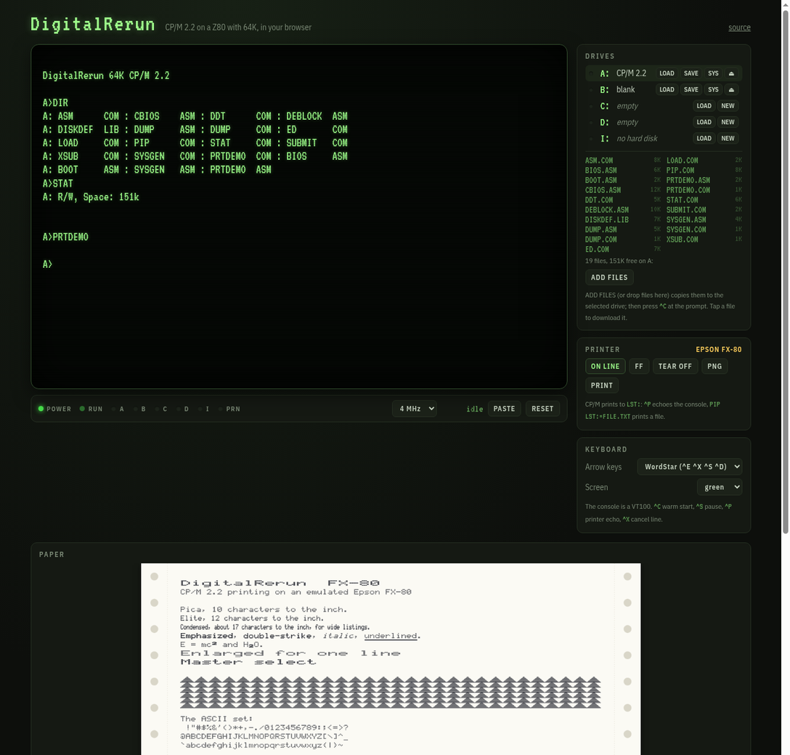

# DigitalRerun

[](https://github.com/cstroie/DigitalRerun/actions/workflows/test.yml)

*Digital Research's CP/M, running again.* A CP/M 2.2 computer in the browser: a Z80 with 64K of RAM, the **original Digital Research CCP and BDOS**, booted by a real BIOS from the system tracks of an 8" disk, four floppy drives and a hard disk, a VT100 console and an Epson FX-80 printer that prints on fanfold paper. There are no dependencies and no build step.

**Live demo: https://cstroie.github.io/DigitalRerun/**



## Quick start

The machine boots from the CP/M 2.2 disk in A:. B: holds an empty disk.

```
A>DIR
A>STAT B:
A>PIP B:=A:*.COM
A>ED HELLO.ASM
A>ASM HELLO
A>LOAD HELLO
A>PIP LST:=BOOT.ASM          (prints on the FX-80)
```

The A: disk holds the DRI 2.2 tools: PIP, STAT, ED, ASM, LOAD, DDT, SUBMIT, XSUB and DUMP. It also holds SYSGEN and the sources of this machine's BIOS, loader and SYSGEN.

`^C` warm-starts the system, `^S` pauses output and `^P` echoes the console to the printer.

- **Drives.** ADD FILES (or dropping files on the DRIVES panel) copies them to the selected drive, then press `^C` so CP/M logs the disk in again. Click a file to download it. Text files (`.ASM`, `.TXT`, `.SUB` …) are converted between LF and CP/M's CR LF on the way. `LOAD` inserts a `.dsk` image, `SAVE` downloads one, and `NEW` inserts a blank, bootable disk. Disks are kept in the browser (IndexedDB) and are still there after a reload.
- **Speed.** The CPU runs at 2, 4 (the default) or 8 MHz, or as fast as the browser allows. It costs nothing while CP/M waits for a key.
- **Lights.** POWER, RUN (bright while working, dim while waiting for a key), one light per drive, and PRN.

## The machine

| | |
|---|---|
| CPU | Z80 ([Z80.js](https://github.com/DrGoldfire/Z80.js), passes ZEXDOC) |
| Memory | 64K RAM. CCP at `E400h`, BDOS at `EC00h`, BIOS at `FA00h` |
| A: to D: | 8" IBM 3740 SSSD: 77 tracks, 26 sectors of 128 bytes, skew 6, 2 system tracks, 241K. The same images work with cpmtools (`ibm-3740`) and z80pack |
| I: | 4 MB hard disk, z80pack geometry (255 tracks × 128 sectors) |
| Console | VT100 subset, 80 × 24 |
| Printer | Epson FX-80 on `LST:` |

I/O ports. The disk controller ports are z80pack's:

| Port | In | Out |
|---|---|---|
| 0 | console status: `0FFh` when a key waits | |
| 1 | console data | console data |
| 2 | printer status: `0FFh` when on line | |
| 3 | | printer data |
| 10 | `0FFh` when the drive holds a disk | drive |
| 11, 12, 17 | | track; sector (low, high) |
| 15, 16 | | DMA address (low, high) |
| 13 | | command: 0 read, 1 write |
| 14 | status of the last command (0 = ok) | |

At reset, the "boot ROM" loads sector 1 of track 0 into `0000h` and jumps there. That sector is [`system/boot.asm`](system/boot.asm), which reads CCP, BDOS and BIOS from the system tracks and jumps to the BIOS. Nothing about CP/M is built into the emulator: the system is whatever the boot disk holds.

## Changing the system

The BIOS ([`system/bios.asm`](system/bios.asm)) is 8080 code in the syntax of DRI's `ASM.COM`. You can change it inside CP/M, the way it was done in 1980:

```
A>ED BIOS.ASM                 change it
A>SYSGEN                      source A, RETURN; destination RETURN (the image stays in memory)
A>SAVE 34 CPM64.COM
A>ASM BIOS
A>DDT CPM64.COM
-IBIOS.HEX
-R2580                        the BIOS runs at FA00h; in the image it sits at 1F80h
-G0
A>SYSGEN                      source RETURN (use memory), destination A
```

Then press RESET. From outside, the SYS button of a drive writes a system tracks image (up to 6656 bytes: the loader at 0, CCP at 80h, BDOS at 880h, BIOS at 1680h, like `system/cpm22.bin`) onto the disk in it. In the SYSGEN image the loader is at `0900h`, the CCP at `0980h`, the BDOS at `1180h` and the BIOS at `1F80h`, so the same recipe can also replace the CCP or the BDOS (ZCPR, ZSDOS, …) with their own offsets.

On the host side, `node tools/build.js` assembles `system/*.asm` and the DRI sources with [`js/asm8080.js`](js/asm8080.js), a two-pass 8080 assembler for the DRI ASM and Macro Assembler AS dialects. It then writes `system/cpm22.bin` (the system tracks) and `disks/cpm22.dsk`. The CCP and BDOS it produces are byte for byte Digital Research's: a test checks them against the binaries on the CP/M 2.2 distribution disk.

## The printer

The FX-80 strikes dots from its own 9-pin font onto 9½" fanfold sheets with tractor holes. You can download the sheets as PNG, or print them (or save as PDF) from the PRINTER panel. TEAR OFF starts a fresh sheet.

It understands:
- CR, LF, FF, BS, HT;
- SO/DC4 (enlarged for one line) and SI/DC2 (condensed);
- `ESC E/F` emphasized, `ESC G/H` double-strike, `ESC 4/5` italic, `ESC -` underline;
- `ESC W` enlarged, `ESC S/T` super- and subscript, `ESC M/P` elite and pica, `ESC !` master select;
- `ESC 0 1 2 3 A J` line spacing;
- `ESC C N O` form length and skipping the perforation;
- `ESC D` tabs, `ESC l Q` margins;
- `ESC K L Y Z *` bit images;
- `ESC @` reset;
- codes `80h`–`FFh`, which print in italics.

Other sequences are skipped together with their parameters.

## Files

```
index.html, css/, js/app.js    the page
js/z80.js                      the Z80 core (vendored, MIT)
js/machine.js                  RAM, ports, run loop, boot ROM
js/devices/fdc.js, serial.js   disk controller, console and printer ports
js/terminal.js                 VT100 terminal and its view
js/fx80.js, js/font9.js        FX-80 printer, paper view, dot-matrix font
js/cpmfs.js                    CP/M file system on a disk image (outside the machine)
js/asm8080.js                  8080 assembler (DRI ASM / Macro Assembler AS syntax)
js/storage.js                  disks and settings in IndexedDB
system/                        loader, BIOS, SYSGEN sources; dri/ CCP and BDOS sources
disks/cpm22/, cpm22.dsk        the files of the boot disk and the disk image
tools/build.js                 assemble the system and make the boot disk
tools/font9.txt, font9.js      the printer font as dot pictures, and its generator
```

## Tests

```
node --test                          assembler, file system, terminal, printer, booting CP/M
ZEX=1 node --test test/zex.test.js   ZEXDOC on the Z80 core (a few minutes; ZEX=all adds ZEXALL)
```

The machine tests boot the real disk and type at the CCP. They cover DIR, STAT, PIP, ASM, printing and SYSGEN, and the whole change-the-BIOS recipe above.

## Credits and licences

The code of this project is under the MIT licence ([LICENSE](LICENSE)).

- **CP/M 2.2** (CCP, BDOS, the utilities): Digital Research. It is redistributed under the 2022 permission from DRDOS, Inc. ([LICENSE-DRI](LICENSE-DRI)). The sources are [Eric Smith's reformatting](https://github.com/brouhaha/cpm22) of DRI's.
- **Z80.js**: Molly Howell and contributors, MIT.
- **ZEXDOC/ZEXALL**: Frank Cringle (GPL). They are downloaded by the test and not shipped.
- The I/O port layout and the disk formats follow Udo Munk's [z80pack](https://github.com/udo-munk/z80pack).
