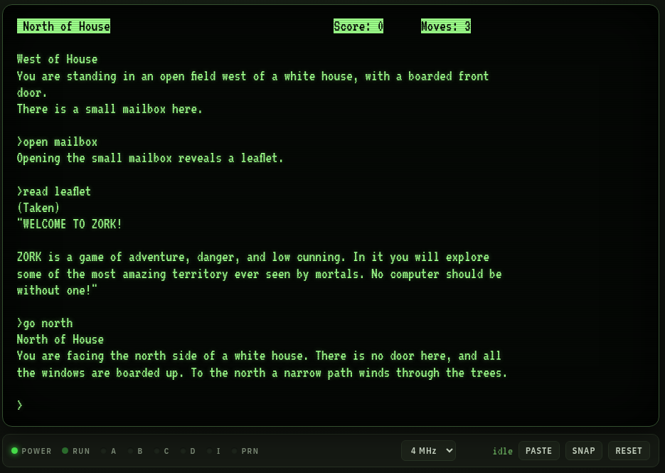
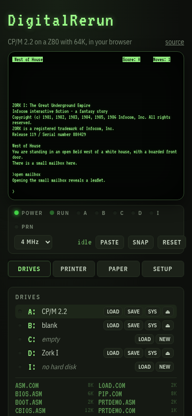

<div align="center">

# DigitalRerun

### CP/M 2.2, running again: a whole 1980s computer in your browser

[](https://github.com/cstroie/DigitalRerun/actions/workflows/test.yml)
[](https://cstroie.github.io/DigitalRerun/)
[](LICENSE)


**[▶ Boot it now](https://cstroie.github.io/DigitalRerun/)**: no install, no sign-up, no download.


</div>

DigitalRerun is a complete CP/M 2.2 machine that runs in a web page:
- a **Z80 with 64K** of RAM;
- **8" floppy drives** and a 4 MB hard disk;
- a **VT100** or **ADM-3A** console with a glowing phosphor screen;
- an **FX-80 dot matrix printer** that strikes its dots onto fanfold paper, tractor holes and all.

It is not a CP/M look-alike. The machine boots the **original CP/M 2.2 CCP and BDOS**, byte for byte as they shipped, read by a real BIOS from the system tracks of an 8" disk. Everything CP/M did then, it does here: `PIP`, `ED`, `ASM`, `DDT`, `SUBMIT`. You can even rebuild the BIOS inside CP/M with the 1980 recipe and boot the result.

It is a single web page with no dependencies, no build step and no server. It installs as an app, works offline, and keeps your disks and your place between visits.

## Why you'll like it

- **The real thing.** The original CP/M 2.2 system, assembled from source by the project's own assembler into exactly the binaries on the 1979 distribution disk. A test checks every byte.
- **Zork I comes with it.** The great underground empire is on drive D:, ready to play.
- **A printer you can watch.** PRTDEMO shows off pica, elite, condensed, bold, italic, underlined, enlarged, super- and subscript text and bit-image graphics. Save the pages as PNG or PDF.
- **Snapshots.** Freeze the whole machine (CPU, memory, screen and disks) and come back to that exact moment later, even mid-game. Leave the page and it resumes where you were.
- **Bring your own software.** Drop `.COM` files or whole `.dsk` images onto a drive. Disks use the standard 8" format of cpmtools and z80pack.
- **Hackable to the bone.** The BIOS, the boot loader and SYSGEN are short, commented 8080 sources on the boot disk. Change them with `ED`, assemble them with `ASM`, install them with `SYSGEN`.
- **It sounds right.** The bell, the clunk of an 8" drive loading its head, the clicks of the head stepping across tracks, and the rasp of the print head. All are synthesized, and a SETUP switch turns them off.
- **Screenshots.** SHOT saves the screen as a PNG, phosphor glow and scan lines included.
- **Phone friendly.** A key row adds what phone keyboards lack (CTRL, ESC, TAB, arrows, ^C), ADD FILES replaces drag and drop, the printed paper gets its own tab, and the 80 columns stay readable.
- **Paste a whole listing.** PASTE types at a careful typist's pace, waiting for the program to ask for each key, so nothing is lost, not even in programs that read the keyboard ahead.

<div align="center">


&nbsp;


</div>

## Try it

Open **https://cstroie.github.io/DigitalRerun/**, click the screen and type:

```
A>DIR                        what is on the disk
A>STAT B:                    room on the empty disk in B:
A>PIP B:=A:*.COM             copy the programs to B:
A>PRTDEMO                    print a page (see PAPER)
A>D:                         to the game disk
D>VEZZA ZORK1.Z3             and you are standing west of a white house
```

A: holds the CP/M 2.2 tools (PIP, STAT, ED, ASM, LOAD, DDT, SUBMIT, XSUB, DUMP), SYSGEN, PRTDEMO, and the sources of the BIOS, the loader and SYSGEN. B: holds an empty disk, and D: holds Zork I.

`^C` warm-starts the system, `^S` pauses the output and `^P` echoes the console to the printer. In Zork, `SAVE` and `RESTORE` keep your progress on the disk.

## What's inside

### The machine

| | |
|---|---|
| CPU | Z80, passes the ZEXDOC instruction exerciser, at 2, 4 or 8 MHz or as fast as the browser goes. It costs nothing while CP/M waits for a key |
| Memory | 64K RAM. CCP at `E400h`, BDOS at `EC00h`, BIOS at `FA00h` |
| A: to D: | 8" single-sided, single-density: 77 tracks of 26 × 128-byte sectors, skew 6, 2 system tracks, 241K. Compatible with cpmtools (`ibm-3740`) and z80pack |
| I: | 4 MB hard disk, z80pack geometry |
| Console | VT100 (subset) or ADM-3A, chosen in SETUP; exactly 80 × 24 at any window size, green, amber or white phosphor; WordStar, VT100 or ADM-3A arrow keys. Typing reaches the machine wherever the focus is on the page (except form fields) |
| Printer | FX-80 compatible, on `LST:` |
| Lights | POWER, RUN (bright while working, dim while waiting), one per drive, PRN |

At reset, the "boot ROM" loads sector 1 of track 0 into `0000h` and jumps there. That sector is [`system/boot.asm`](system/boot.asm), which reads CCP, BDOS and BIOS from the system tracks and starts the BIOS. Nothing about CP/M is built into the emulator: the system is whatever the boot disk holds.

The I/O ports follow z80pack for the disk controller:

| Port | In | Out |
|---|---|---|
| 0 | console status: `0FFh` when a key waits | |
| 1 | console data | console data |
| 2 | printer status: `0FFh` when on line | |
| 3 | | printer data |
| 10 | `0FFh` when the drive holds a disk | drive |
| 11, 12, 17 | | track; sector (low, high) |
| 15, 16 | | DMA address (low, high) |
| 13 | | command: 0 read, 1 write |
| 14 | status of the last command (0 = ok) | |

### The panels

Tabs above the side column show one panel at a time: DRIVES, PRINTER and SETUP (and PAPER on a phone). The front strip under the screen has the lights, the speed, PASTE, SHOT (a PNG of the screen), SNAP and RESET.

### The console

SETUP chooses the terminal: **VT100** (the default) or **ADM-3A**. Install your programs for the same one; WordStar, Turbo Pascal and most CP/M software list both. You can switch at any time, and the screen is kept.

- **VT100:** cursor moves and addressing, erasing, bold, dim, underline, blink and reverse video, scroll regions, inserting and deleting lines and characters, and cursor and status reports.
- **ADM-3A:** `ESC =` cursor addressing, `^Z` clear, `^^` home, and `^H ^J ^K ^L` moves. The 80th character wraps at once, as on the real terminal. It also accepts the extensions that later ADM-compatible terminals added and many CP/M programs send:
  - `ESC T` / `ESC Y` erase to the end of the line or the screen;
  - `ESC *` clears the screen;
  - `ESC E` / `ESC R` insert or delete a line;
  - `ESC Q` / `ESC W` insert or delete a character;
  - `ESC )` / `ESC (` half intensity;
  - `ESC G n` and `ESC B n` / `ESC C n` attributes.

The arrow keys send WordStar's `^E ^X ^S ^D`, VT100's `ESC [ A …` or ADM-3A's `^K ^J ^H ^L`. Terminal arrow keys follow the terminal when you switch.

### Drives and files

- **ADD FILES** (or dropping files on the DRIVES panel) copies them to the selected drive. Then press `^C`, so CP/M logs the disk in again.
- Click a file to download it. Text files (`.ASM`, `.TXT`, `.SUB` …) are converted between LF and CP/M's CR LF on the way in and out.
- Each drive has these buttons:
  - **LOAD** inserts a `.dsk` image;
  - **SAVE** downloads one;
  - **NEW** asks for a label and inserts a blank, bootable disk;
  - **SYS** writes a system tracks image onto a disk.
- Disks are kept in the browser (IndexedDB), and they are still there tomorrow.

### Changing the system, the 1980 way

The BIOS ([`system/bios.asm`](system/bios.asm)) is 8080 code in the syntax of CP/M's own `ASM.COM`. Change it inside CP/M:

```
A>ED BIOS.ASM                 change it
A>SYSGEN                      source A, RETURN; destination RETURN (the image stays in memory)
A>SAVE 34 CPM64.COM
A>ASM BIOS
A>DDT CPM64.COM
-IBIOS.HEX
-R2580                        the BIOS runs at FA00h; in the image it sits at 1F80h
-G0
A>SYSGEN                      source RETURN (use memory), destination A
```

Then press RESET and your BIOS boots. In the SYSGEN image the loader sits at `0900h`, the CCP at `0980h`, the BDOS at `1180h` and the BIOS at `1F80h`, so the same recipe also swaps in another CCP or BDOS (ZCPR, ZSDOS …).

On the host, `node tools/build.js` assembles everything with [`js/asm8080.js`](js/asm8080.js), a two-pass 8080 assembler that reads both the ASM.COM and the Macro Assembler AS dialects. It writes `system/cpm22.bin` (the system tracks), `disks/cpm22.dsk` and `disks/zork1.dsk`.

### The printer

The FX-80 strikes dots from its own 9-pin font onto 9½" fanfold sheets. From the PRINTER panel you can download the sheets as PNG or print them (or save as PDF), and TEAR OFF starts a fresh sheet. It understands:

- CR, LF, FF, BS, HT;
- SO/DC4 (enlarged for one line), SI/DC2 (condensed);
- `ESC E/F` emphasized, `ESC G/H` double-strike, `ESC 4/5` italic, `ESC -` underline;
- `ESC W` enlarged, `ESC S/T` super- and subscript, `ESC M/P` elite and pica, `ESC !` master select;
- `ESC 0 1 2 3 A J` line spacing;
- `ESC C N O` form length and skipping the perforation;
- `ESC D` tabs, `ESC l Q` margins;
- `ESC K L Y Z *` bit images;
- `ESC @` reset;
- codes `80h`–`FFh`, which print in italics.

Other sequences are skipped together with their parameters.

### Snapshots

A snapshot is the whole machine at one moment: CPU, memory, screen, printer head, and a copy of every disk, so memory and disks always agree.

- **SNAP** (next to RESET) or **SAVE SNAPSHOT** (in SETUP) keeps one, up to twelve. Each shows its time and the last line on the screen.
- **RESTORE** goes back to that moment, even in the middle of a program or a game.
- With *Save when I leave, and resume there* on (the default), an automatic snapshot is also kept. It is saved when the page is hidden or closed, when the window loses focus, and once a minute while the machine works. The next visit continues where you left off.

The printed paper is not part of a snapshot.

### As an app

DigitalRerun is a progressive web app:

- **Install.** Where the browser can install apps, a banner offers INSTALL. On an iPhone or iPad it explains *Share, then Add to Home Screen*.
- **Offline.** After the first visit everything is kept, the disks included, and the app starts with no network.
- **Updates.** A new version downloads in the background. A banner names it and offers RELOAD; your disks are saved first. SETUP shows the running version and has CHECK FOR UPDATES.

## For developers

```
git clone https://github.com/cstroie/DigitalRerun.git
cd DigitalRerun
python3 -m http.server 8000         # any static server; then open http://localhost:8000
node --test                         # 38 tests: assembler, file system, terminal, printer, CP/M, snapshots, PWA
ZEX=1 node --test test/zex.test.js  # ZEXDOC on the Z80 core (a few minutes; ZEX=all adds ZEXALL)
```

The machine tests boot the real disk and type at the CCP. They cover:
- `DIR`, `STAT`, `PIP`, `ASM`, printing and `SYSGEN`;
- the whole change-the-BIOS recipe above;
- Zork;
- restoring snapshots.

Releasing a change: raise `VERSION` in [`js/version.js`](js/version.js) and run `node tools/stamp.js`. The build stamp is a hash of every file the app keeps offline, and a test fails when it is stale.

```
index.html, css/, js/app.js       the page
js/z80.js                         the Z80 core (vendored)
js/machine.js                     RAM, ports, run loop, boot ROM, machine state
js/devices/fdc.js, serial.js      disk controller, console and printer ports
js/terminal.js                    VT100 terminal and its view
js/fx80.js, js/font9.js           printer, paper view, dot matrix font
js/cpmfs.js                       CP/M file system on a disk image, from outside the machine
js/asm8080.js                     8080 assembler
js/storage.js                     disks, settings and snapshots in IndexedDB
js/snapshot.js                    take and restore a snapshot
js/sound.js                       bell, drive and printer sounds (Web Audio, synthesized)
js/version.js, js/pwa.js, sw.js   version and build stamp; install, updates, offline
system/                           loader, BIOS, SYSGEN, PRTDEMO; cpm22/: the original CCP and BDOS sources
disks/cpm22/, disks/zork1/        the files of the boot disk and the game disk, and their images
tools/build.js                    assemble the system, make the disks
tools/stamp.js                    write the build stamp
tools/font9.txt, font9.js         the printer font as dot pictures, and its generator
```

## Credits

DigitalRerun stands on the work of many people, with thanks to all of them.

**CP/M**
- **Gary Kildall** created CP/M at **Digital Research, Inc.** in Pacific Grove, California. This project is named in its honour: Digital Research's system, running again.
- **DRDOS, Inc.** and its president **Bryan Sparks** granted everyone the right to use, distribute and modify CP/M and its derivatives (2022, at **Scott Chapman**'s request). See [LICENSE-DRI](LICENSE-DRI).
- **Eric Smith** reformatted the CCP and BDOS sources for cross-assembly ([brouhaha/cpm22](https://github.com/brouhaha/cpm22)); they are in `system/cpm22/`.
- **Gaby Chaudry**'s [Unofficial CP/M Web Site](http://www.cpm.z80.de/) keeps CP/M's history, its sources and the licence. It is where the CP/M 2.2 distribution files on A: come from.

**Emulation**
- **Molly Howell** and contributors wrote [Z80.js](https://github.com/DrGoldfire/Z80.js), the Z80 core (MIT).
- **Frank Cringle** wrote the ZEXDOC/ZEXALL instruction exercisers (GPL). **Tony Nicholson** keeps them at [agn453/ZEXALL](https://github.com/agn453/ZEXALL). They are downloaded by the test and not shipped.
- **Udo Munk**'s [z80pack](https://github.com/udo-munk/z80pack) set the I/O port layout and the disk formats, and **Michael Haardt**'s cpmtools set the format names.
- The 8" format is the IBM 3740 single-sided, single-density layout.
- The printer follows the published command set of the **Epson FX-80**. Its 9-pin font was drawn for this project, not copied from Epson's character ROM.

**Zork I**
- *Zork I: The Great Underground Empire* is by **Marc Blank** and **Dave Lebling** at **Infocom, Inc.**, from the original MIT *Zork* by **Tim Anderson, Marc Blank, Bruce Daniels and Dave Lebling**.
- In 2025 **Microsoft**'s Open Source Programs Office, **Team Xbox** and **Activision**, working with **Jason Scott** of the Internet Archive, released it under the MIT licence ([historicalsource/zork1](https://github.com/historicalsource/zork1)). `disks/zork1/ZORK1.Z3` is that repository's compiled story file.
- **Shawn Sijnstra** wrote [Vezza](https://gitlab.com/sijnstra1/vezza), the Z-machine interpreter for CP/M that plays it (GPL-2.0-or-later). `disks/zork1/VEZZA.COM` is its `vezza-C2` build, unchanged.

**Fonts**
- [VT323](https://fonts.google.com/specimen/VT323) by **Peter Hull**, and [IBM Plex Sans Condensed](https://github.com/IBM/plex) by **Mike Abbink** and **Bold Monday**, both under the SIL Open Font License.

## Licence

DigitalRerun's own code is under the [MIT licence](LICENSE). The parts that come from elsewhere keep their own licences, listed in [LICENSE](LICENSE):
- CP/M under the DRDOS, Inc. grant ([LICENSE-DRI](LICENSE-DRI));
- Z80.js under MIT;
- Zork I under MIT;
- Vezza under GPL-2.0-or-later (its licence is in `disks/zork1/`).

**Trademarks.** CP/M was created by Gary Kildall at Digital Research, Inc.; the rights now belong to DRDOS, Inc. Epson and FX-80 are trademarks of Seiko Epson Corporation. Z80 is a trademark of Zilog, Inc. IBM and IBM Plex are trademarks of International Business Machines Corporation. VT100 was a terminal by Digital Equipment Corporation, and ADM-3A one by Lear Siegler, Inc. ZORK is a trademark of its owner. Names are used only to say what DigitalRerun emulates or contains. DigitalRerun is not affiliated with, or endorsed by, any of these companies.
